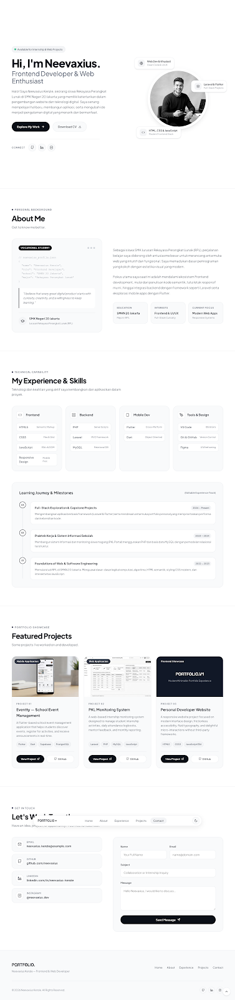

# Neevaxius Kenzie

  

  
  
  
  
  
  
  

  <strong>Portfolio • Frontend Developer • Web Enthusiast</strong>

## About Me

Hi, I'm <strong>Neevaxius Kenzie</strong>, a student of Software Engineering at <strong>SMK Negeri 20 Jakarta</strong> with a strong interest in website development and digital technology. I enjoy learning new things, building applications, and turning ideas into useful and engaging digital experiences.

My focus is on modern frontend development, responsive interfaces, and the practical use of technologies such as HTML, CSS, JavaScript, PHP, Laravel, Flutter, and MySQL. I also like exploring clean UI design and writing maintainable code.

## Tech Stack

### Frontend
- HTML5
- CSS3
- JavaScript (ES6+)
- Responsive Design
- Semantic Markup

### Backend
- PHP
- Laravel
- MySQL

### Mobile
- Flutter
- Dart

### Tools & Workflow
- VS Code
- Git & GitHub
- Figma

## Featured Projects

### 1. Eventty — School Event Management
A Flutter-based school event management application designed to help students discover events, register for activities, and receive announcements in real time.

**Tech:** Flutter, Dart, Supabase, PostgreSQL

**Highlights:**
- Mobile-first event management experience
- Event discovery and registration flow
- Announcement and activity updates

### 2. SIMAS — Asset Management System
A web-based application designed to streamline asset management and data recording. The system helps organize asset information and improve operational efficiency.

**Tech:** Laravel, PHP, JavaScript, MySQL/PostgreSQL

**Highlights:**
- Asset data management
- Structured information recording
- Documentation-friendly workflow for asset tracking

### 3. Personal Developer Website
A responsive personal portfolio website focused on modern interface design, accessibility, fluid typography, and micro-interactions.

**Tech:** HTML5, CSS3, JavaScript ES6

**Highlights:**
- Clean minimalist design
- Responsive layout
- Smooth UI interactions and navigation

## Skills

### Programming Languages
- HTML
- CSS
- JavaScript
- PHP
- Dart

### Frameworks & Libraries
- Laravel
- Flutter

### Database
- MySQL
- PostgreSQL

### Design & Development Tools
- Figma
- VS Code
- Git
- GitHub

## Contact

- Email: [kenziemuara@gmail.com](mailto:kenziemuara@gmail.com)
- GitHub: [Kenzie-Felix](https://github.com/Kenzie-Felix)

## Profile Summary

A focused and curious developer building experience in frontend, backend, and mobile technology with a strong interest in creating digital products that are practical, aesthetic, and easy to use.

---

  

